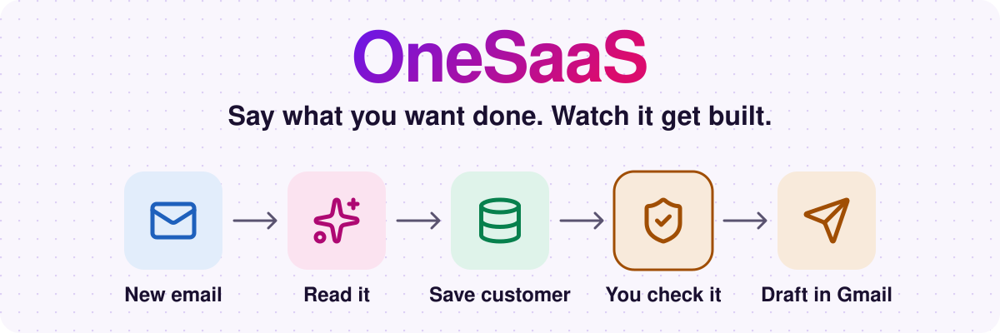
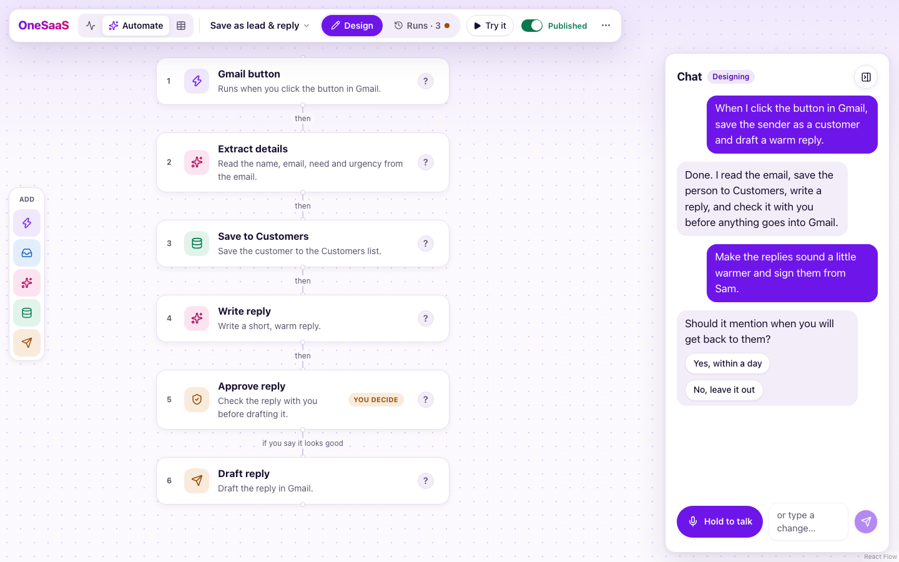
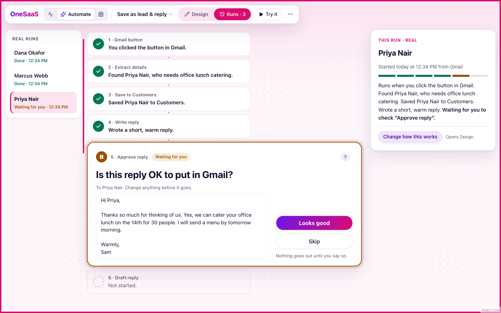
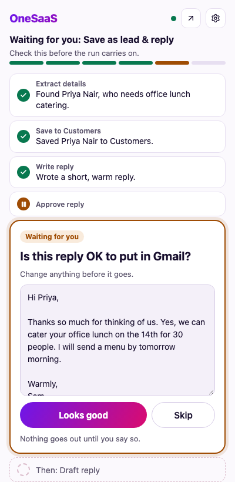
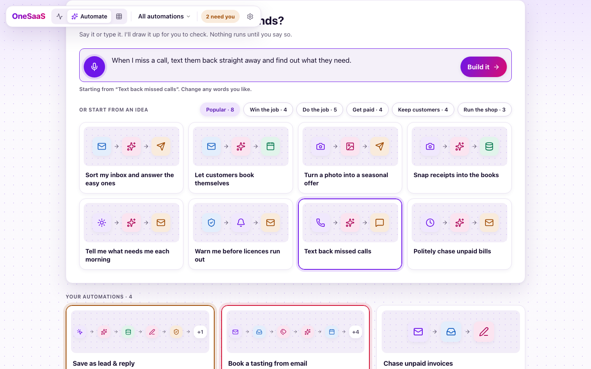
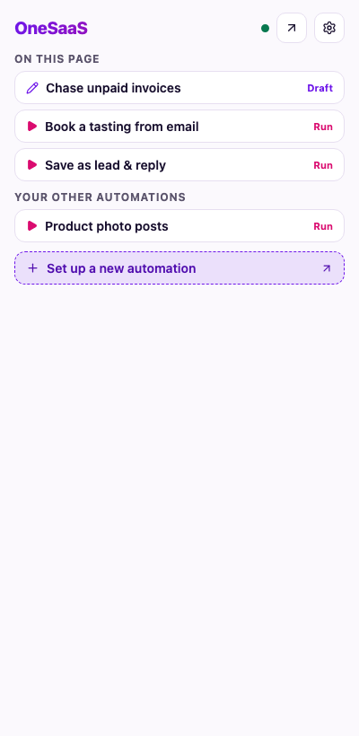
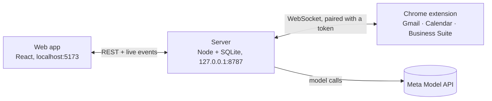

DEMO VIDEO -> [OneSaaS Demo](https://www.youtube.com/watch?v=t4S4Or2H2GM)

<p align="center">
  
</p>

<h1 align="center">OneSaaS: One SaaS to rule them all</h1>

<p align="center">The tool that builds small-business apps. Say what you want done, watch the automation get built, and check it before anything goes out.</p>

<p align="center"><strong>Demo video — link to be added before submission</strong> · <a href="#try-it-in-5-minutes">Try it in 5 minutes</a> · <a href="#how-it-uses-metas-models">How it uses Meta's models</a></p>




My dad runs his small business out of Gmail and memory, and every evening the same chores eat him: answer customers, track bookings, turn phone photos into posts. This app doesn't do one of those chores. It's the tool that *builds* automations for them. He says what he wants to achieve, out loud, and watches it get built in front of him: a plan first, then the real steps, a test run, then Publish. Every step says why in plain English, nothing ever sends itself, and the whole thing runs on his own computer.

Built for the Meta AI Developer Hackathon: Indie Developer track, "Build for Your World".

## See it work

| You stay in charge | Run it from the page you're on |
| :---: | :---: |
|  |  |
| A run stops and waits for you before anything goes out. | The Chrome side panel runs your automations and shows what they did. |

Start from your own words, or from 20 ideas based on small-business playbooks:



## Try it in 5 minutes

You need [Node 24](https://nodejs.org), [pnpm 9](https://pnpm.io/installation), Chrome, and an API key. Gmail, Calendar and Business Suite steps also need you signed in to those sites in Chrome.

### 1. Start the app with your API key

```sh
git clone https://github.com/thinkjones/meta-ai-hackathon-my-dads-ai-agent.git
cd meta-ai-hackathon-my-dads-ai-agent
pnpm install
MODEL_API_KEY=your-key pnpm start
```

Then open **<http://localhost:5173>** and follow the setup steps. `pnpm start` also builds the Chrome extension, ready for the next step.

> [!TIP]
> **No key to hand, or a typo?** Start without one. Setup has a step that checks your key and lets you paste one in. After setup, the app checks it on every launch and opens **Settings → AI model endpoint** if it's missing or turned down.

### 2. Install the Chrome extension

> [!IMPORTANT]
> The app needs this extension. It's how OneSaaS works in your Gmail, Calendar and Business Suite tabs.

1. Open `chrome://extensions` in Chrome.
2. Turn on **Developer mode** (top right).
3. Click **Load unpacked** and choose the `apps/extension/.output/chrome-mv3` folder in this repo.
4. Pin **OneSaaS** to your toolbar and click its icon to open the side panel.

Using the desktop app instead? The extension comes with it: the **Chrome extension** step of setup has a **Get the extension** button that puts it in `~/OneSaaS Extension` and shows you these same steps.

### 3. Pair it with the app

1. The **Chrome extension** step of setup shows a 6-digit code. If you skipped it, click **Connect Chrome** on the **Chrome extension** card in **Settings**.
2. Enter the code in the extension's side panel and press **Pair**.

You only do this once.

### 4. Build your first automation

On the **Automate** page, pick an idea or say what you want, then press **Build it**. If it shows you a plan first, answer **Build it** in the chat. Press **Try it** for a safe test, and when you're happy, turn on **Published** and run it from the side panel.

## Setting up your API key

Use whichever suits you. A key saved in the app takes priority over the environment variable.

| Option | How | Good for |
| --- | --- | --- |
| **Environment variable** | `MODEL_API_KEY=your-key pnpm start` | Getting started in one line |
| **In the app** | **Settings → AI model endpoint**, paste your key, press **Save** | No restart needed |

Get a Meta Model API key at [api.meta.ai](https://api.meta.ai).

**Using another provider?** In the same Settings card, add the URL and model name of any OpenAI-compatible service. Chat, the builder and page reading then use it. Images and voice are Meta-only, so they need a Meta key in `MODEL_API_KEY`.

Your key stays on your computer and is never sent to the browser.

## What the Chrome extension does

The side panel does two things: **run your automations** and **show you the results**, including approving a step that's waiting for you. You build and change automations in the app. Its settings screen handles pairing.



It acts in your own logged-in tabs, so the server never holds your Google or Meta passwords. It can read any site, because a manual automation can use whichever page you're on, but it only reads a page when you click run.

## How it uses Meta's models

Every model does a real job. Role defaults live in [`apps/server/src/models/gateway.ts`](apps/server/src/models/gateway.ts).

| Model | What it does | File |
| ----- | ------------ | ---- |
| Muse Spark 1.3 (`muse-spark-1.3`) | The builder agent's tool loop | [`agent/loop.ts`](apps/server/src/agent/loop.ts) |
| Muse Spark 1.3 | Extract, write and classify steps | [`steps/ai.ts`](apps/server/src/steps/ai.ts), [`steps/classify.ts`](apps/server/src/steps/classify.ts) |
| Muse Spark 1.3 | "Explain anything" answers | [`explain/explain.ts`](apps/server/src/explain/explain.ts) |
| Muse Spark 1.3 | Screenshot vision fallback for unmapped pages | [`bridge/vision.ts`](apps/server/src/bridge/vision.ts) |
| Muse Wonder 1.0 (`muse-wonder-1.0`) | Plans complex requests: more than six steps, or branching | [`agent/tools.ts`](apps/server/src/agent/tools.ts) |
| Muse Voice Transcribe (`muse-voice-transcribe-1.0`) | Push-to-talk in realtime, proxied so the key stays on the server | [`voice/proxy.ts`](apps/server/src/voice/proxy.ts) |
| Muse Image (`muse-image-1.0`) | Image generate and edit steps | [`steps/image.ts`](apps/server/src/steps/image.ts) |
| SAM 3.1 (`sam-3.1`) | Cuts a product out of a phone photo | [`steps/image.ts`](apps/server/src/steps/image.ts) |
| Muse Glimmer (local, optional) | Sorts the inbox on your own machine; falls back to Spark | [`models/gateway.ts`](apps/server/src/models/gateway.ts) |

File paths are under `apps/server/src/`.

<details>
<summary>Optional: run inbox sorting locally on Muse Glimmer</summary>

Load Muse Glimmer in [LM Studio](https://lmstudio.ai), start its local server, then set these before `pnpm start`:

```sh
export GLIMMER_BASE_URL=http://127.0.0.1:1234/v1
export GLIMMER_MODEL=the-model-id-shown-in-lm-studio
```

**Settings → Thinking** shows when it's in use. If it isn't running, inbox sorting uses Muse Spark instead.

</details>

## How it works

Three pieces run on your computer. The server never calls Google or Meta's business tools directly: every Gmail, Calendar and Business Suite action goes through the extension in your logged-in tabs.



An automation is a graph of typed steps: triggers, AI, your lists, Gmail, Calendar, images and approvals. The builder agent can only change it through the same checked operations the canvas uses, and the engine logs why each step did what it did.

## Your data stays on your computer

- One local SQLite file. Nothing leaves your machine except model calls.
- The server binds to localhost only, and the extension must present a pairing token.
- Model calls send only the fields each step needs.
- **Nothing sends or posts by itself.** Gmail replies and Meta posts are always drafts, with an approval step, that you send yourself.

## What was built during the hackathon

Everything in this repo. There is no pre-existing code: the monorepo, the engine, the builder agent, the extension and the design are all new work from the event, and the commit history starts on Oct 28, 2026.

## Good to know

- The app is built for desktop, at 1280px wide or more. Only setup and the Automate page work on a phone.
- Extension features depend on the page layouts of Gmail, Calendar and Business Suite, so a site change can break a step. When that happens, the run stops and tells you.

## For developers

```sh
pnpm test        # run all tests
pnpm typecheck   # typecheck every package
pnpm demo:reset  # wipe the database back to a clean start (server stopped)
pnpm tauri:dev   # run the desktop app
```

## Licence and assets

MIT, see [LICENSE](LICENSE). Every image and fixture in the repo is listed with its source, licence and author in [ASSETS.md](ASSETS.md).
