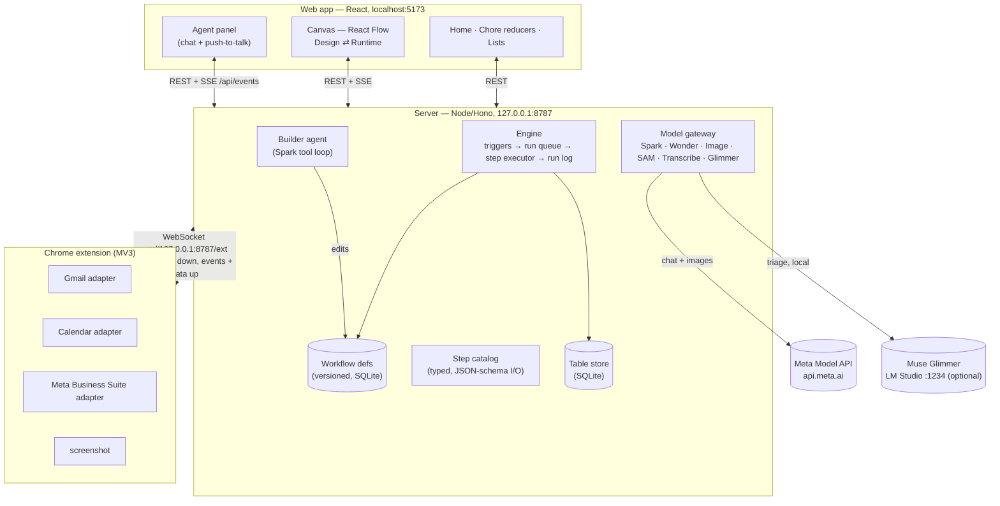

# Architecture

Three processes, all on the user's own computer. The web app and the server
talk REST + SSE; the Chrome extension talks to the server over a WebSocket.
The server never calls Google or Meta directly — every Gmail, Calendar and
Meta Business Suite action runs through the extension in the user's
logged-in tabs.

## Repo layout (pnpm workspaces monorepo)

- `apps/web` — Vite + React: onboarding, home, canvas (design/runtime),
  pairing, run log. Dev server on `localhost:5173`.
- `apps/server` — Node + Hono API on `127.0.0.1:8787` (`PORT` env overrides):
  model gateway, table store, workflow engine, WebSocket bridge, voice proxy.
  Local state in `data/` (`app.db`, `files/`; both gitignored).
- `apps/extension` — WXT (MV3): Gmail/Calendar/Meta adapters injected into the
  inbox; background worker holds the WebSocket with a 20 s heartbeat.
- `packages/shared` — zod schemas shared by server, web and extension (step
  catalog, workflow/run types, extension protocol).

## Request paths

- **Builder:** web chat/voice → `POST /api/agent/*` → Spark tool loop in
  `apps/server/src/agent/loop.ts` → `apps/server/src/workflows/ops.ts`
  (validated against the catalog in `packages/shared`). Every edit versions
  the workflow; canvas updates stream back over `GET /api/events` (SSE).
- **Runs:** triggers (Gmail button, new email, upload, manual) → engine in
  `apps/server/src/engine/engine.ts` → per-step executors in
  `apps/server/src/steps/` → every step saves a StepRun (`input`, `output`,
  `model`, `why`) before the run moves on.
- **Extension actions:** step executors send `{ id, site, action, input }`
  over the bridge (`apps/server/src/bridge/`); the background worker
  (`apps/extension/lib/background.ts`) routes each command to an open tab of
  that site and returns `{ id, ok, output | error }`.
- **Voice:** browser mic → AudioWorklet 24 kHz PCM → `/api/voice` WebSocket →
  proxied to the Meta realtime endpoint with the server-held key
  (`apps/server/src/voice/proxy.ts`). The browser never sees `MODEL_API_KEY`.
- **Inbox triage:** new mail → `apps/server/src/triggers/email.ts` →
  `triage` role on Muse Glimmer when healthy, else Spark
  (see [docs/glimmer.md](glimmer.md)).

## Model map

| Model | Job | Where |
| ----- | --- | ----- |
| Muse Spark 1.3 (`muse-spark-1.3`) | Builder agent, `ai.extract` / `ai.write` / `ai.classify`, explanations, screenshot vision fallback, triage fallback | `apps/server/src/agent/loop.ts`, `apps/server/src/steps/ai.ts`, `apps/server/src/steps/classify.ts`, `apps/server/src/explain/explain.ts`, `apps/server/src/bridge/vision.ts` |
| Muse Wonder 1.0 (`muse-wonder-1.0`) | `propose_plan` for complex requests (> ~6 steps or branching) | `apps/server/src/agent/tools.ts` |
| Muse Voice Transcribe (`muse-voice-transcribe-1.0`) | Push-to-talk input, realtime with end-of-speech detection | `apps/server/src/voice/proxy.ts`, `apps/web/src/voice/` |
| Muse Image (`muse-image-1.0`) | Onboarding + mood backgrounds, `image.generate` / `image.edit` steps | `apps/server/src/models/image.ts`, `apps/server/src/mood/generate.ts`, `apps/server/src/steps/image.ts` |
| SAM 3.1 (`sam-3.1`) | `image.cutout` (product cut out of a phone photo) | `apps/server/src/models/image.ts`, `apps/server/src/steps/image.ts` |
| Muse Glimmer (local, via LM Studio) | Inbox triage before `trigger.email` fires; falls back to Spark | `apps/server/src/models/gateway.ts`, `apps/server/src/main.ts`, [docs/glimmer.md](glimmer.md) |
| Muse Code | The coding agent this project was built with | — |

Gateway role defaults (`apps/server/src/models/gateway.ts`):
`{ builder: spark-1.3, planner: wonder-1.0, triage: glimmer | spark-1.3, vision: spark-1.3 }`.
There is no Meta text-to-speech model, so the app listens but replies in text.

## Data safety

- One local SQLite file (`data/app.db`); nothing leaves the machine except
  Meta model calls.
- The server binds to localhost only; the extension only connects to
  localhost and must present a pairing token.
- Model calls send only the fields each step needs.
- Glimmer triage keeps routine inbox filtering on the machine.
- Nothing sends or posts automatically — Gmail replies and Meta posts are
  always drafts (plus an approval step) that Dad sends himself.
